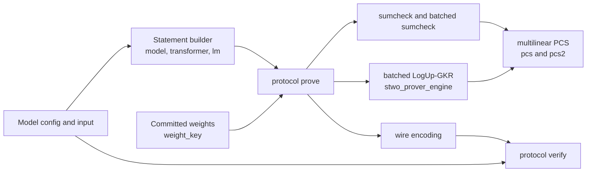

# Integer-inference frontend

Public module `stwo_int_inference_frontend`.

The integer-inference frontend proves integer neural-network computations
directly over M31: matrix multiplies with requantization, lookups, range
checks, and the transformer operations built from them (grouped-query
attention, causal softmax, RMSNorm, RoPE, SwiGLU, top-1 MoE routing). It owns
the operation semantics, the witness and the statement a verifier rebuilds
from a public model description. The tensor product line (`src/products/tensor`,
a later slice of issue #438) owns command-line tools and benchmarks.

| Property | Value |
| --- | --- |
| Version | `0.2.0` |
| Layer | `frontend` |
| Owner | `int-inference-frontend` |
| Public Zig module | `stwo_int_inference_frontend` |
| Focused CI host | Linux |

## Purpose and architecture

The statement is: "the committed integer model, run on this input, produces
this output". Weights are int8 tables committed once in a multilinear
commitment, with a one-time weight key (a range proof and a proximity proof)
that each client checks once. Per batch, the prover commits a witness table and
proves a list of operations over committed tensors. Every operation reduces to
claims on multilinear extensions; one batched LogUp-GKR proves all range and
table lookups, and its terminal claims bind directly to the committed tensors.



The PCS is Ligero-style: rows are circle-polynomial coefficients encoded with
the stwo circle FFT and committed with a Blake2s Merkle tree. `pcs2` is the
recursive two-level variant with optional out-of-domain samples. The `zk`
namespaces provide the hiding variants of the sumcheck, the PCS and the whole
protocol. `serve` proves several requests against one shared weight opening.
`security` accounts the soundness of each proof term by term at a declared
security level. The challenge field is QM31 by default; `-Dchallenge=om31`
builds the degree-8 field used for the 128-bit and 160-bit levels.

Device acceleration is a boundary, not a dependency: `accel.Accel` is a
vtable a device integration can fill in, every entry may decline, and results
must be bit-identical to the CPU path. This package has no backend code.

## Public API

```zig
const inference = @import("stwo_int_inference_frontend");
var weights = try inference.protocol.commitWeights(allocator, &pool, config, infos, tables);
var timings: inference.protocol.Timings = .{};
const proof = try inference.protocol.prove(allocator, &pool, config, statement, &weights, witness, &timings);
try inference.protocol.verify(allocator, config, statement, inference.protocol.weightKey(&weights), &proof);
```

The facade exposes these namespaces:

- Field and transcript: `field`, `transcript`, `digest`, `canonical`.
- Sumcheck and linear algebra: `sumcheck`, `batch_sumcheck`, `batch`,
  `batch_eq`, `eqsum`, `linalg`, `prep`, `recycle`.
- Commitments: `pcs`, `pcs2`, `weight_key`.
- Protocol and statements: `protocol`, `model`, `ext`, `transformer`, `lm`,
  `serve`, `proof_digest`, `wire`.
- Hiding variants: `zk`, `zk_pcs`, `zk_pcs2`, `zk_sumcheck`.
- Soundness accounting: `security`.
- Witness accounting: `ledger` (committed tensors and LogUp leaves per
  label; a caller sets `ledger.sink` around a prove call, and proofs are
  unchanged with it on).
- Device hook: `accel`.

Verifiers must build statements themselves (`model.mlpStatement`,
`transformer.statementFor`, the `lm` request builders) from a public
configuration, the input and the claimed output; they never accept a
prover-supplied statement. Decoders (`wire`) reject non-canonical field
elements, unknown tags, truncation and trailing bytes before verification.

## Dependencies

- `stwo_core`: M31, QM31 and OM31 fields, Blake2s hashing and channels,
  circle points.
- `stwo_prover_engine`: the batched LogUp-GKR prover and verifier, circle
  transforms and twiddles.

The build injects `int_inference_options` (the challenge degree). There are no
other dependencies.

## Build, test, and run

```sh
zig build test --build-file src/frontends/int_inference/build.zig -Doptimize=ReleaseFast -j2
zig build test --build-file src/frontends/int_inference/build.zig -Doptimize=Debug -j2
zig build test --build-file src/frontends/int_inference/build.zig -Doptimize=ReleaseFast -Dchallenge=om31 -j2
```

The three commands form the focused CI lane. The Debug run takes about nine
minutes on a laptop. `-Dtest-filter=<text>` selects tests by name. Test
discovery lives in `mod.zig`; each split `*_test.zig` file is imported next
to its facade, in the challenge-field branch where its tests apply.

## Contract and invariants

- Proofs round-trip byte-identically through `wire` and verify from bytes.
- Pinned proof digests (`proof_digest`, the golden decoder-layer and hiding
  digests) are independent of thread counts and change only with a protocol
  revision.
- Tampered proofs, statements, keys and witnesses are rejected; the honest
  prover refuses witnesses outside the integer model.
- Every transmitted field element is canonical (`canonical.check`) before any
  arithmetic. Core field arithmetic is defined on canonical values only.
- Statistical hiding tests draw prover randomness from a seed derived from
  the test name (`zk.testSeedFor`); production proofs always use OS entropy.
- Witness volume (protocol 0.2.0): attention keeps D virtual (the exp key
  reads m - S - Bias) and uses a factored argmax selector (A ⊗ B one-hots);
  a wide range above 16 bits is one key into range(bits) when the rule
  `wideKeyDirect(n, bits)` allows it (nothing committed), else 16-bit limbs;
  and the SwiGLU gate is one glu triple lookup at ≥ 2^16 gate elements.
  The rules depend only on shapes the verifier rebuilds from the model
  description. Version 0.2.0 changes proof bytes relative to 0.1.0.
- The weight-key denominators are materialised for the GKR prover; the archived
  lazy-regeneration hook in the shared GKR prover was not ported.

The invariant tests listed in `package.contract.json` pin these rules.

## Change checklist

- Keep each source file under the 850-line manual-source ceiling.
- A change to proof bytes is a protocol revision: update the pinned digests in
  the same change and say so.
- Keep the core consumer test in `contract_tests/` in step with the core
  behavior this package relies on.
- Do not add backend code here; device paths belong in an integration package.
- Report the complexity budget for every change.

## Related documentation

- [Design notes](../../../design/tensor-frontend/README.md)
- [Security accounting](../../../design/tensor-frontend/security.md)
- [Hiding protocol](../../../design/tensor-frontend/zk.md)
- [Wire format](../../../design/tensor-frontend/wire.md)
- [Witness ledger and volume levers](../../../design/tensor-frontend/ledger.md)
- [Frontends index](../README.md)
- Issue #438 tracks the port; the archived branch head is `97dc093f2`.
